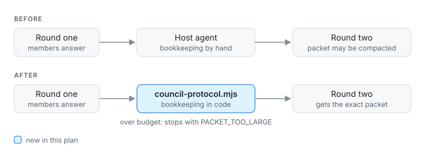
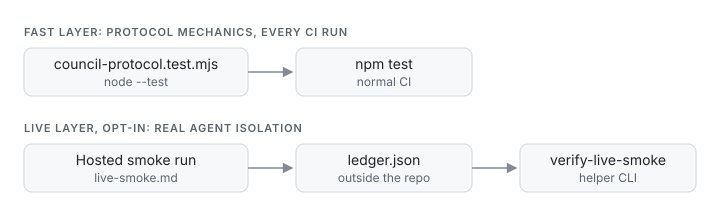

# Council skill: bookkeeping moved into code, evidence never trimmed

**Status:** complete · Full plan for the agent: [plan.md](plan.md)

The Council skill's round bookkeeping moved out of its 622-line prompt into `council-protocol.mjs`, a helper built only on Node.js built-ins. A real hosted run had shown that long round-two packets may be compacted and bookkeeping is easy to get wrong; code now guards both.

## What changes
- `council-protocol.mjs` took over brief checks, routing, member selection, vote parsing, convergence and anonymous labels.
- A round-two packet over its budget fails with `PACKET_TOO_LARGE`; nothing is truncated or summarised.
- `SKILL.md` became a router of at most 220 lines; the detail moved to four files in `references/`.
- Council runs unasked for hard-to-reverse architecture choices; strategy and mission prioritisation need an explicit request.
- `npm test` now runs the fast Council suite in normal CI.
- An opt-in hosted smoke run saves a ledger that the helper verifies.

## Your call
Nothing needs your decision: the plan is complete and has no open questions.

## Already decided
- The helper uses Node.js built-ins only: no existing package fit a closed-network, same-model protocol.
- The model keeps semantic judgement; code enforces only the invariants that failed in practice.
- Hybrid routing is user-selected skill behaviour, not a repository-wide commitment, so no ADR was written.
- 2026-11-20: "do 1,2,3,5" plus the hybrid routing choice counted as approval; no second planning pause.
- 2026-11-20: review found prompt and truthiness bypasses; the verifier now rebuilds full prompts and requires typed JSON.

## Risks
| Risk | What the plan does about it |
|---|---|
| A local Node process cannot spawn hosted agents | The live layer stays opt-in; its saved ledger is verified deterministically |
| Character budgets only approximate model tokens | The caller supplies the budget and the helper fails closed |
| Member prose may name personas | Headers stay anonymous and bytes are preserved; prose is not redacted |
| The shared checkout holds another session's release edits | Work and push from the isolated branch only |
| `.plan` is ignored in this repository | Only this plan file is force-added |

## Not in this plan
- A standalone LLM or sub-agent runtime: the host still spawns the agents.
- Mixing model providers, or giving personas different models.
- Automating subjective calls, such as whether two arguments share one reason.
- Any skill outside `skills/council`, except wiring its tests into `npm test`.
- Anything in `skills/rank-workspace`.
- A retry policy for hosted timeouts, and two orchestrators sharing one ledger.

## How we will know it worked

- Fast suite: `node --test skills/council/tests/council-protocol.test.mjs`.
- Repository gates: `npm test`, `npm run validate`, `npm pack --dry-run --json`, `git diff --check`.
- A saved ledger passes `node skills/council/scripts/council-protocol.mjs verify-live-smoke /absolute/path/to/ledger.json`.
- 2026-11-20: the live smoke passed with four round-one and five fresh round-two contexts.
- Its 7,001-character evidence packet fit unchanged in a 9,588-character maximum prompt.
