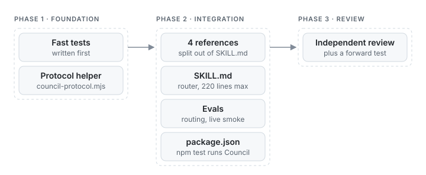

# Make Council dependable: a tested helper script takes over the bookkeeping

**Status:** complete, for your review · Full plan for the agent: [plan.md](plan.md)

Council's long round-two packets could be compacted, and its prompt bookkeeping was easy to do inconsistently. This plan moves that bookkeeping into a dependency-free Node helper that refuses an over-budget packet instead of shortening it.

## What changes
- `skills/council/scripts/council-protocol.mjs` checks briefs, votes, anonymous labels and round-two prompts.
- An over-budget packet stops with `PACKET_TOO_LARGE`. Nothing is summarized or cut.
- `skills/council/SKILL.md` shrinks from 622 lines to at most 220 and becomes a router.
- Personas, protocol, verdict rules and the live-smoke procedure move to four files in `references/`.
- Council starts by itself only for hard-to-reverse architecture decisions. Strategy and prioritization need an explicit request.
- `npm test` runs the fast Council tests.

## Your call
Nothing needs your decision. The plan lists no open question.

## Already decided
- Node built-ins only: existing council packages would have replaced the skill's design.
- The model keeps the judgment; the helper takes only the invariants that failed in practice.
- Tests come first: phase 1 watches them fail before the helper exists.
- All work is sequential under one owner, `root`.
- After review found bypasses, the verifier rebuilds complete prompts and requires typed JSON inputs.
- No ADR: the routing policy is a user-chosen skill behavior, not a repository-wide commitment.

## Risks
| Risk | What the plan does about it |
|---|---|
| A local Node process cannot spawn hosted agents | Live smoke stays opt-in; the helper verifies its saved ledger |
| Character budgets only approximate model tokens | The caller supplies the budget; the helper fails closed |
| Persona text may mention names inside an argument | Headers are anonymous and bytes preserved; prose is not redacted |
| The active checkout holds another session's release edits | Work and push from the isolated branch only |
| `.plan` is ignored by repository convention | Force-add only this plan file |

## Not in this plan
- A standalone LLM or sub-agent runtime: the host still spawns the agents.
- Mixed model providers, or a different model per persona.
- Automating subjective judgments, such as whether two arguments share a reason.
- Any skill outside `skills/council`, except the test wiring in `package.json`.
- Anything in `skills/rank-workspace`.
- A retry policy for agent timeouts, and two orchestrators writing one ledger.

## How we will know it worked
- `node --test skills/council/tests/council-protocol.test.mjs` passes.
- `npm test` and `npm run validate` pass; the baseline was 20 tests, 25 skills and 2 agents.
- `npm pack --dry-run --json` and `git diff --check` are clean.
- `node skills/council/scripts/council-protocol.mjs verify-live-smoke /absolute/path/to/ledger.json` accepts a real ledger.
- Recorded 2026-11-20: live smoke passed; the 7,001-character packet fit unchanged in a 9,588-character maximum prompt.
- A fresh reviewer finds no unresolved critical or high finding.
