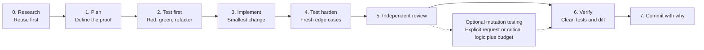
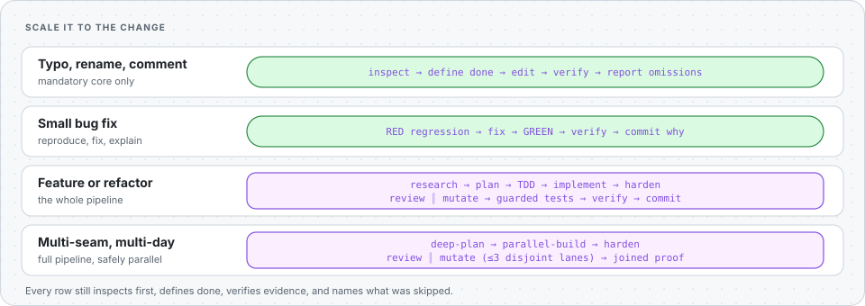

<picture>
  <source media="(prefers-color-scheme: dark)" srcset="assets/readme/hero-dark.svg">
  
</picture>

One repository for the skills I want every coding agent to share. A skill is an
ordinary folder with a `SKILL.md`; this repo keeps the useful ones together,
tests them, and links the same source into each agent.

Three things make the setup work:

- **One source of truth.** Update a skill here once; every symlinked agent sees
  the change immediately.
- **Native everywhere.** The same 27 skills serve Claude Code, OpenAI Codex,
  GitHub Copilot, Tabnine, and tools that follow the shared `.agents` convention.
- **Safe to own.** The installer detects conflicts before replacing anything,
  validation runs across operating systems, and external work stays attributed.

## Contents

- [Why this exists](#why-this-exists)
- [Quick start](#quick-start)
- [How it works](#how-it-works)
- [The workflow](#the-workflow)
- [The skills](#the-skills)
- [Original agents](#original-agents)
- [Writing a portable skill](#writing-your-own-portable-skill)
- [Good skills that live elsewhere](#good-skills-that-live-elsewhere)

## Why this exists

I use four coding agents, and I got tired of teaching each one the same lessons:
how I want plans written, how I want commits to explain *why*, which functional
patterns I actually want in TypeScript. So the lessons live here once, and a
small installer links them into every agent at the same time.

They're ordinary [Agent Skills](https://agentskills.io): a folder with a
`SKILL.md`. The format is the same everywhere; only the directory each agent
watches differs, and the installer knows all of them.

The installer **symlinks** by default. That matters: there is exactly one real
copy of each skill, here, so a single `git pull` updates every agent at once.

## Quick start

**Interactive.** The installer detects your agents, asks which skills you want,
and asks whether to link or copy:

```bash
git clone https://github.com/MatanelGordon/skills.git
cd skills
npm install
npm run install-skills
```

Reinstalls identify links and copies created by this repo. An edited managed
copy, an unmarked copy, a foreign link, or unrelated same-named content is a
conflict: interactive installs can move it to a timestamped backup first;
noninteractive installs keep it in place, report the conflict, and exit
nonzero.

**Non-interactive.** For when you're in a hurry, or scripting it:

```bash
node install/index.mjs --yes          # everything, every detected agent
node install/index.mjs --yes --copy   # copies instead of symlinks
node install/index.mjs --yes --all    # force every platform, detected or not
```

**Without cloning.** Run `npx github:MatanelGordon/skills` to try it. This
always installs copies, because npx runs from a temporary cache and symlinks
into it would eventually break. The installer notices and does the right thing.

**Living with it afterwards:**

```bash
node install/index.mjs list        # what's installed where, and how
node install/index.mjs doctor      # finds broken links (e.g. you moved this repo)
node install/index.mjs uninstall   # clean removal from any or all agents
```

To confirm the install, run `copilot skill list` or `tabnine skills list`.
Claude Code and Codex pick skills up on the next session.

> [!NOTE]
> **Windows:** where symlinks need developer mode, the installer falls back to
> copying. Several skills ship `.sh`/`.py` helper scripts that want a POSIX
> shell, so use Git Bash or WSL for those.

## How it works

<picture>
  <source media="(prefers-color-scheme: dark)" srcset="assets/readme/install-flow-dark.svg">
  
</picture>

| Agent | Where the installer puts skills |
|---|---|
| Claude Code | `~/.claude/skills/` (plus the two agents in `~/.claude/agents/`) |
| OpenAI Codex | `~/.codex/skills/` and the shared `.agents/skills/` convention |
| GitHub Copilot | `~/.copilot/skills/` |
| Tabnine | `~/.tabnine/agent/skills/` |
| Shared convention | `~/.agents/skills/` |

**Symlink or copy.** A symlinked skill *is* the folder in this repo, so it
follows every `git pull`. A copy is independent: edit it per agent if you like,
but it won't see updates. Managed copies carry an ownership marker, so a later
install can distinguish them from content it must preserve. `list` tells you
which is which.

**About `~/.agents/skills/`.** It's a cross-tool convention that Tabnine reads,
as do OpenCode, Cursor and Gemini CLI, so installing there also covers tools this
repo doesn't target yet. It does not replace the per-agent rows. In a check on
2026-10-02, Copilot CLI didn't discover a skill there until it was linked into
`~/.copilot/skills/`.

**About Codex.** OpenAI documents two conventions:
[`.agents/skills/` and `~/.agents/skills/`](https://developers.openai.com/api/reference/cli)
in the CLI reference, and
[`.codex/skills/` and `~/.codex/skills/`](https://developers.openai.com/blog/eval-skills)
elsewhere. The installer's Codex target writes `~/.codex/skills/`. The shared
target is a separate choice. If you aren't sure which one your Codex build
reads, select both.

## The workflow

You don't run these skills by hand. Each one's description tells the agent when
to use it, so you ask for what you want and the right skills come in on their
own. [`development-workflow`](skills/development-workflow/SKILL.md) is the spine
that keeps them in order:



0. **Research.** Before writing code, check whether it already exists in a
   registry, on GitHub, or in your codebase. If something proven covers about 80%
   of the need, use it. Any shaky claim the work depends on gets checked first.
1. **Plan.** Read the repository's past decisions, then write down what will
   change and what will prove it worked. For anything wider than a couple of
   files, that becomes a `deep-plan`, which `plan-reviewer` reads with fresh eyes.
2. **Test first.** Write the test and watch it fail for the right reason. Then
   make it pass, then clean up. A test you never saw fail proves nothing.
3. **Implement.** The smallest change that does the job, following the plan.
   Work big enough to split goes to `parallel-build`.
4. **Test harden.** A fresh subagent reads the completed diff and adds tests for
   edge cases created by the implementation—not more production code. Then the
   green state is frozen.
5. **Review.** Someone who didn't write the code reviews it. Mutation testing is
   separate and opt-in: run it when explicitly requested, or when a configured
   engine can cheaply probe plan-marked critical decision logic inside an
   approved budget. The mutation branch is never merged.
6. **Verify.** Rerun clean relevant and repository tests and inspect the diff.
   If mutation testing was selected, import paths rather than candidate history
   and rerun its agreed proofs. Incomplete evidence stops that optional stage
   for a user risk decision; it is never reported as complete.
7. **Commit.** The message says *why*. Hard-to-reverse calls become ADRs.

Not every change needs the full feature pipeline. Scale it honestly:

<picture>
  <source media="(prefers-color-scheme: dark)" srcset="assets/readme/workflow-scale-dark.svg">
  
</picture>

Skipping a step is fine. Skipping it *silently* isn't: one sentence saying why
keeps it a decision instead of drift.

## The skills

Each name links to its `SKILL.md`. An arrow (→) marks a skill that pulls in
others when you install it.

### Planning and execution

| Skill | What it does |
|---|---|
| [development-workflow](skills/development-workflow/SKILL.md) | The spine: research → plan → test-first → implement → test-harden → review → verify → commit. Mutation testing is an explicit risk/value option, not a default feature gate. → `research-first`, `confidence-ranker`, `deep-plan`, `test-hardening`, `mutation-testing`, `adr` |
| [test-hardening](skills/test-hardening/SKILL.md) | Fresh post-implementation eyes add bounded tests for observable edge cases. Red proof happens in a scratch copy/worktree, production defects return as regressions, and hosts without subagents use a declared fresh-context fallback. |
| [mutation-testing](skills/mutation-testing/SKILL.md) | Opt-in native mutation testing for an explicit scope or budgeted critical logic. Five adapters preserve engine meanings; a direct-parent Git guard rejects production history and imports only reviewed test paths. → `test-hardening` |
| [deep-plan](skills/deep-plan/SKILL.md) | Turns "build X" into a plan someone with zero context could execute: a clarity gate before any writing, one owner per file path, every edge case enumerated with a status, and test commands quoted verbatim. Owns `.plan/`. |
| [council](skills/council/SKILL.md) | Pressure-tests consequential architecture choices with isolated, contrast-written personas, anonymized cross-review, and a chairman verdict that preserves dissent. Weights falsifiers over confidence theatre. Built for weak single-model harnesses on closed networks. |
| [prototype](skills/prototype/SKILL.md) | Throwaway code that answers a design question before real work burns tokens on the wrong thing. Greenfield: hardcode everything, delete it after. Brownfield: deliberately bad code behind exactly one seam, so the real thing lands as a one-line swap. |
| [get-the-job-done](skills/get-the-job-done/SKILL.md) | Guards against work that only *looks* finished. Completion claims become `GATES.md` entries, each with a runnable `CHECK`, and a bundled checker re-runs them. Read-only and hook-free on purpose, so it survives six concurrent agents. |
| [parallel-build](skills/parallel-build/SKILL.md) | Executes a plan across parallel subagents in three phases (foundation → implementation → review). Its `PROGRESS.md` lets a fresh session resume after a crash. → `cli-coding-subagents`, `deep-plan` |
| [cli-coding-subagents](skills/cli-coding-subagents/SKILL.md) | The machinery underneath: runs codex and copilot as autonomous workers in git worktrees. Includes quota pre-flight (it asks before spending paid overage), strict prompt contracts, and merge and cleanup that never leave a worktree behind. |
| [openrouter-cli-subagent](skills/openrouter-cli-subagent/SKILL.md) | The same workflow routed through OpenRouter via the `ori` CLI, so subagent work costs cents. Finds models that can actually call tools, under a price ceiling (default $0.50 per 1M output tokens). Checks the wallet before recommending anything paid. → `cli-coding-subagents` |

<details>
<summary>Why get-the-job-done is hook-free, and why openrouter isn't free-only</summary>

<br>

**get-the-job-done** targets the done report at 80%, the scope that quietly
shrank, and the summary with a number nobody checked. A ticked box that has
since become false gets caught instead of believed. It deliberately ships no
blocking hook: a blocker you can't cleanly remove is worse than the premature
"done" it prevents.

**openrouter-cli-subagent** sets a price ceiling instead of insisting on free
models, because free-only leaves one model family and a 20 req/min cap, and a
few cents gets you out of both. It discovers which models can really call
tools (a free million-token model that turns out to be a *music* model is not a
coding agent). It also splits author and reviewer context floors, so
cross-model review is actually possible.

</details>

### Decisions and memory

| Skill | What it does |
|---|---|
| [critical-thinking](skills/critical-thinking/SKILL.md) | Anything flagged for your decision arrives as an honest comparison table: pros, cons, cost, reversibility, a recommendation that admits its own downside, and the do-nothing default. No "you might want to consider…" paragraphs. |
| [research-first](skills/research-first/SKILL.md) | Before building, sweep registries and GitHub for something that already fits. Before any consequential answer, stand it on two independent sources. "Redundant" code is checked against both the code and its git history. → `confidence-ranker` |
| [confidence-ranker](skills/confidence-ranker/SKILL.md) | Builds justified confidence before an answer drives an action: isolates the deciding claims, gathers the cheapest decisive evidence, ranks each claim, and reports READY / READY WITH CAVEAT / NOT READY. `/confidence` audits the previous answer. |
| [adr](skills/adr/SKILL.md) | Architectural Decision Records as small files in `.adr/`, read *before* planning so past decisions don't get undone by accident. |
| [bookkeeper](skills/bookkeeper/SKILL.md) | Durable, non-derivable repository facts as small tagged entries in `.memory/`, with an index read first for cheap PageIndex lookup. |

### Code style

| Skill | What it does |
|---|---|
| [functional-typescript](skills/functional-typescript/SKILL.md) | Discriminated unions, `Result` over thrown exceptions, zod on both sides of every JSON boundary. |
| [functional-csharp](skills/functional-csharp/SKILL.md) | Records, sealed-record unions, railway-oriented error handling. |
| [functional-python](skills/functional-python/SKILL.md) | Frozen dataclasses, tagged unions with exhaustive `match`, `Result` over raising. |

### Interfaces

This registry deliberately installs **`impeccable-lite`**, not the upstream
`impeccable` package. Lite is the maintained local workflow for interface work.

| Skill | What it does |
|---|---|
| [impeccable-lite](skills/impeccable-lite/SKILL.md) | Compact interface direction and finish with an optional perception-first diagnostic, a built-ins-only workflow/audit, and deterministic local screenshots through the repository's narrow Puppeteer capture companion. |
| [ux](skills/ux/SKILL.md) | A style-agnostic way to answer "is this good UX?" with a rubric instead of an opinion: severity-rated heuristics plus metrics with published thresholds. |
| [terminal-ux](skills/terminal-ux/SKILL.md) | Terminal dashboards and visualisations with Ink, including the testing traps I hit so you don't have to. |
| [tui-builder](skills/tui-builder/SKILL.md) | Full-screen TUI work, with hard-won terminal-resize rules. |
| [visual-plan](skills/visual-plan/SKILL.md) | Turns text plans into reviewable visual plans with diagrams, file maps, and annotated code. |

### Driving and observing

Manual testing by hand, not test suites.

| Skill | What it does |
|---|---|
| [terminal-interaction](skills/terminal-interaction/SKILL.md) | Drives a CLI, TUI, REPL or installer the way a human tester would: launch, send keys, read the screen back, report. Looks for an existing MCP server or skill first, ships a zero-install PTY driver as a fallback, and polls for the expected output instead of using `sleep 2`. |
| [browser-interaction](skills/browser-interaction/SKILL.md) | Clicks through a page and reports what happened with structured, console, network, and visual evidence. Uses native search/browser capability first; shell-only agents can fall back to a pinned, hardened Chrome DevTools terminal client without registering an MCP surface. |
| [desktop-interaction](skills/desktop-interaction/SKILL.md) | Drives Electron, Tauri and pywebview apps, launched under control or attached over a debugging port. Electron support is strong. `tauri-driver` has no macOS support, and pywebview on macOS can't be driven. Webview apps only. |

### Architecture

| Skill | What it does |
|---|---|
| [vertical-slice](skills/vertical-slice/SKILL.md) | Organise code by feature, not by technical layer. |

### Things that need more than markdown

Most skills are pure guidance and run anywhere. A few assume real tooling. The
installer flags these at the end of a run, selects dependencies automatically,
and skips platform-locked skills on the wrong OS.

| Skill | Needs |
|---|---|
| `impeccable-lite` | Node ≥ 18 for its optional local workflow/audit and an installed Chrome, Chromium, or Edge browser for screenshots; registry checkouts may use the pre-provisioned Puppeteer companion, while copied and npx installs retain a built-ins-only fallback. |
| `mutation-testing` | Node ≥ 18 + git for protocol gates; a compatible native engine for execution. Worktree-free hosts need a disposable clone/copy. |
| `cli-coding-subagents` | codex + copilot CLIs, installed and authenticated |
| `parallel-build` | the above, plus git worktrees |
| `openrouter-cli-subagent` | the `ori` CLI on PATH and an OpenRouter credential |
| `terminal-ux` / `tui-builder` | Node ≥ 22 (Ink) |

### Optional local browser capture

`browser-capture` is a repository tool, not a general browsing skill and not an
MCP server. It uses exact-pinned `puppeteer-core` with an already-installed
Chrome-family browser to render local HTML at explicit viewports. The preview
binds to loopback, a process-owned deny proxy contains and records external
attempts, WebRTC UDP is disabled, evidence is hash-bound and atomically
published, and no browser is downloaded.

Provision it once from this checkout, then verify the launcher:

```bash
npm run setup:browser-capture
node tools/browser-capture/launcher.mjs doctor
```

The core registry remains Node 18 compatible. The launcher selects the lowest
compatible installed LTS from common nvm, fnm, asdf, mise, n, Volta, Homebrew,
and PATH locations without changing the machine default. Symlinked installs use
the verified repository tool. Copied and npx installs retain a built-ins-only
capture fallback, so they can still finish the evidence-gated workflow without
installing anything. An explicit `BROWSER_CAPTURE_CLI` must pass the tool's JSON
identity handshake. `npm run test:browser-capture` runs the real-Chrome
containment, diagnostics, lifecycle, and negative-control suite.

General browsing stays in `browser-interaction`: native harness search/control
comes first. In a shell-only CLI, the optional official `chrome-devtools`
client is a deep-inspection fallback, pinned and hardened as documented in the
skill. Its explicit page-scoped user-agent override is a one-retry compatibility
diagnostic, not a guaranteed anti-blocking or stealth mode. It is deliberately
separate from Impeccable's offline capture boundary.

## Original agents

Two original subagents live in [`agents/`](agents/). They do work rather than
restate guidance. Each is an agent instead of a skill because the job needs what
only a subagent has: fresh context and a budget it can spend and throw away.

| Agent | Why it's a separate agent |
|---|---|
| [plan-reviewer](agents/plan-reviewer.md) | Reviews a `plan.md` before dispatch. The author is the worst-placed person to spot their own missing seam, so this runs with zero authoring context. Returns VERDICT / BLOCKERS / NON-BLOCKING. |
| [code-archaeologist](agents/code-archaeologist.md) | Answers "why does this exist, and is it safe to remove?" by walking both the code graph and git history. The dig is bulky, and the caller only needs the verdict with shas. Read-only. |

The installer links both into `~/.claude/agents/` when Claude Code is a target.
They use Claude's subagent format, and other platforms don't read them yet. Each
has a paired `.evals.json` suite, enforced by `npm run validate`.

<details>
<summary>Agents I recommend from upstream</summary>

<br>

The other agents I use are cherry-picks from
[github/awesome-copilot](https://github.com/github/awesome-copilot) (MIT,
GitHub's community pack). They stay upstream's and install from there:

| Agent | What it does |
|---|---|
| `ai-team-dev` / `ai-team-producer` / `ai-team-qa` | a three-role AI team: implementation, sprint coordination, QA |
| `implementation-plan` | generate an implementation plan for a feature or refactor |
| `debug` | structured find-and-fix debugging |

Each has a one-click VS Code install button in the awesome-copilot README, or
you can drop the `.agent.md` into `~/.copilot/agents/`.

</details>

## Writing your own portable skill

The body is just markdown, so write whatever helps. Frontmatter is where
portability lives or dies: Claude Code rejects any key it doesn't recognise,
while other agents accept extras without complaint. Stick to this and you're
safe everywhere:

```yaml
---
name: my-skill
description: >
  What it does and, crucially, when an agent should reach for it. This field
  is the trigger — describe situations, not features.
license: MIT
metadata:
  author: You
---
```

The `metadata` block is free-form. This repo uses it for `requires` (prose,
shown after install), `depends` (read by the installer), and `platform` (gates
installation by OS).

> [!WARNING]
> Don't use `when_to_use`. Codex and Tabnine read it, but Claude Code refuses to
> load the skill.

```bash
npm test
npm run validate
```

These exercise the installer, validator, package contents, and eval harness,
then check the subtle repository invariants: unbalanced code fences, literal
escape characters, script syntax, eval schemas, README coverage, and aligned
release metadata. CI runs them across Node 18/20/22 on Linux, macOS, and
Windows.

Eval JSON is executable rather than decorative. Provide any candidate and
judge commands that read a prompt from stdin and write their answer to stdout;
the judge must return `{ "pass": boolean, "details": string }`:

```bash
node install/run-evals.mjs --skill research-first --id 4 \
  --candidate codex --candidate-arg exec --candidate-arg=- \
  --judge codex --judge-arg exec --judge-arg=-
```

Every `evals/evals.json` follows [EVALS.md](EVALS.md): one format that this
runner, [agent-skills-eval](https://github.com/darkrishabh/agent-skills-eval)
and NVIDIA SkillEvaluator all load as committed, with rules for how many
cases a skill needs, how big a case may be, where fixtures live and how to
word an assertion a grader can check. `npm run normalize-evals` rewrites a
file into that format and is safe to run twice; `npm run validate` fails on
anything a runner could not load.

## Good skills that live elsewhere

These are deliberately not vendored. They belong to their authors and install
fine from upstream.

| Upstream | Why it's on this list |
|---|---|
| [openai/skills](https://github.com/openai/skills) (Apache-2.0, OpenAI) | Four independent Codex copies are installed with bundled licenses and per-copy attribution: `aspnet-core`, `chatgpt-apps`, `cli-creator`, and `frontend-skill`. Their installed revisions were not recorded; update through the curated installer rather than assuming they track `main`. |
| [cursor/plugins — PSTACK](https://github.com/cursor/plugins/tree/main/pstack) (MIT, Lauren Tan) | A broad Cursor-first engineering catalog. Its audited `0.15.44` release had 58 skill descriptions and a router whose TDD/dispatch policy conflicts with this repository's canonical workflow, so it is not installed. `mutation-testing` pins seven narrow principles, carries attribution, and has an opt-in/scheduled check that compares those blobs with upstream `main`; no PSTACK skill or runtime is vendored. |
| [github/awesome-copilot](https://github.com/github/awesome-copilot) (MIT, GitHub) | 29 independent Copilot copies: `acquire-codebase-knowledge`, `batch-files`, `context-map`, `conventional-branch`, `conventional-commit`, `csharp-async`, `csharp-docs`, `csharp-xunit`, `dotnet-best-practices`, `dotnet-design-pattern-review`, `doublecheck`, `draw-io-diagram-generator`, `drawio`, `first-ask`, `mini-context-graph`, `nuget-manager`, `postgresql-code-review`, `postgresql-optimization`, `prd`, `premium-frontend-ui`, `prompt-optimizer`, `react-audit-grep-patterns`, `react-container-presentation-component`, `react18-batching-patterns`, `react18-dep-compatibility`, `react18-lifecycle-patterns`, `refactor`, `sql-code-review`, and `sql-optimization`. Each attribution pins the tree SHA retained by `gh skills install`; these copies do not auto-update. |
| [skovalik/perception-first-design](https://github.com/skovalik/perception-first-design) (CC BY-SA 4.0, Stefan Kovalik / Aurochs) | Psychology-backed five-layer design methodology. `impeccable-lite` contains a bounded attributed adaptation pinned to `1704ff6`; the upstream skill itself is not vendored or installed. Install upstream separately only if you want its broad communication-task trigger, corpus, mandatory learning logs, and repeat-loop workflow. Its share-alike license and trademark notice apply to adaptations. |
| [obra/superpowers](https://github.com/obra/superpowers) | The most-adopted skills framework. Its `writing-plans` shaped `deep-plan`. |
| [mattpocock/skills](https://github.com/mattpocock/skills) (MIT, Matt Pocock) | Engineering workflow; his ADR format seeded `adr`. Twelve independent Copilot copies are installed: `codebase-design`, `domain-modeling`, `grill-me`, `grill-with-docs`, `grilling`, `handoff`, `improve-codebase-architecture`, `setup-matt-pocock-skills`, `tdd`, `teach`, `to-prd`, and `triage`. Their exact revisions were not preserved. |
| Local Copilot skill | `git-guardrails-copilot` has no discoverable external upstream or separate license declaration. Its attribution records that limitation instead of inventing provenance. |
| [rampstackco/claude-skills](https://github.com/rampstackco/claude-skills) | `after-action-report`: a blameless postmortem/AAR framework (timeline, root cause, contributing factors, action items). Needs a frontmatter fix; see below. |
| [ayghri/i-have-adhd](https://github.com/ayghri/i-have-adhd) | ADHD-friendly output shaping: lead with the next action, numbered bounded steps, visible wins. 22k+ stars, actively maintained. Opt in with `/i-have-adhd`; installs cleanly alongside these skills. |
| [tjboudreaux/cc-thinking-skills](https://github.com/tjboudreaux/cc-thinking-skills) | 28 mental-model skills. `thinking-kepner-tregoe` and `thinking-pre-mortem` pair well with `critical-thinking`, which escalates to them for one-way, expensive decisions. |
| [affaan-m/ECC](https://github.com/affaan-m/ECC) | An agent-harness system with ~39 skills under `.agents/skills/`. Four are installed as a set; see below. |
| [TerminalSkills/skills](https://github.com/TerminalSkills/skills) | ~1000 tool-specific skills. |
| [Claude plugin marketplace](https://github.com/anthropics/claude-plugins-official) | Includes `skill-creator`, whose validator these skills pass. |

<details>
<summary><strong>rampstackco/claude-skills</strong>: frontmatter normalization</summary>

<br>

The upstream frontmatter carries keys Claude Code rejects. Fold
`category`/`catalog_summary`/`display_order` under `metadata:` when installing.

</details>

<details>
<summary><strong>affaan-m/ECC</strong>: the four-skill set, its caveats, and the rules layer</summary>

<br>

**The set.** `coding-standards` (naming, KISS/DRY/YAGNI, immutability, code
smells), plus the three it explicitly defers to: `frontend-patterns`
(React/Next.js state, rendering, data fetching), `backend-patterns`
(repository/service layers, N+1, pooling) and `api-design` (REST resource
naming, status codes, pagination, versioning). Install them together, or the
deferrals point at skills that aren't there.

**Caveats.**

- Frontmatter is clean (`name`/`description` only, no normalization needed).
  Each skill ships an `agents/openai.yaml`, which is Codex harness display
  metadata, not a subagent, and Claude Code doesn't need it.
- `coding-standards` points at `rules/common/coding-style.md`, a path relative
  to the ECC repo root. That file isn't installed, so the pointer dangles. It is
  a *different* file from the identically-pathed one in a local
  `~/.claude/rules/` layer, which can serve as the substitute.
- `coding-standards` is the weakest of the four. Its immutability and
  error-handling material restates what a `rules/common/` layer and the
  `functional-*` skills already cover, and its examples come from a
  Next.js/Supabase codebase. The real value is in the three
  framework-specific siblings.

**The rules layer.** ECC's `rules/common/` is the origin of several files in
the local `~/.claude/rules/common/` layer: `coding-style.md`, `hooks.md`,
`patterns.md` and `security.md` are byte-identical copies. `coding-style.md`
was re-synced 2026-08-22 to upstream `adebf3e`, after four months on the
2026-02-05 version. That update added Core Principles (KISS/DRY/YAGNI), Naming
Conventions and Code Smells. The rest of that directory (`agents.md`,
`development-workflow.md`, `testing.md`, `git-workflow.md`, `performance.md`)
is customized locally to reference the skills here and must not be
blind-synced. Provenance for each file is recorded in
`~/.claude/rules/common/ATTRIBUTION.txt`.

</details>

## Credits

Everything here is by **Matanel Gordon** and MIT licensed except
`skills/impeccable-lite/references/perception-first-lens.md`, which is an
attributed CC BY-SA 4.0 adaptation. Where a skill builds on published thinking,
it says so inline. Notable sources:
[Nygard](https://cognitect.com/blog/2011/11/15/documenting-architecture-decisions)
and [MADR](https://adr.github.io/madr/) for the ADR templates, and the
[Lore protocol](https://arxiv.org/html/2603.15566v1) for the git trailer schema.

Changes are tracked in [CHANGELOG.md](CHANGELOG.md). Default license:
[MIT](LICENSE); the named reference records its separate terms in
[`ATTRIBUTION.txt`](skills/impeccable-lite/ATTRIBUTION.txt).
