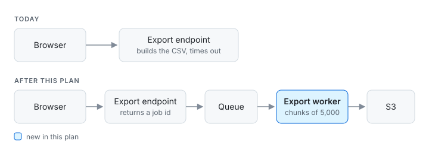

# Report exports move to a background job

**Status:** draft, waiting for your review · Full plan for the agent: [plan.md](plan.md)

Large exports time out because the file is built inside the request. This plan
hands the work to the queue, so the request returns at once and the user gets
a download link.

## What changes

- `POST /reports/:id/export` answers in under a second with a job id.
- A worker builds the CSV in chunks of 5,000 rows and uploads it to S3.
- The export button polls every 3 seconds, then shows the link.
- A 200,000-row export finishes; today anything past about 20,000 rows fails.

## Your call

| # | Question | Options | Recommended | If you say nothing |
|---|---|---|---|---|
| Q1 | How long is an export file kept? | 7 days, 30 days | 7 days | 7 days |
| Q2 | How is the user told the file is ready? | in the page only, or email as well | in the page only | in the page only |

## Already decided

- Background work runs on the existing BullMQ queue (ADR-0007).
- No longer timeout and no streaming: one only moves the limit, the proxy buffers the other.
- Only the worker touches S3.

## Risks

| Risk | What the plan does about it |
|---|---|
| Export files pile up in S3 | A lifecycle rule deletes them (Q1 sets the age) |
| A signed link can be forwarded | It expires after 1 hour; accepted |

## Not in this plan

- Excel and PDF formats.
- Scheduled exports.
- Changes to the columns.

## How we will know it worked

- `npm test` and `npm run test:web -- ExportButton` pass.
- A 200,000-row export on staging produces a link that downloads.
